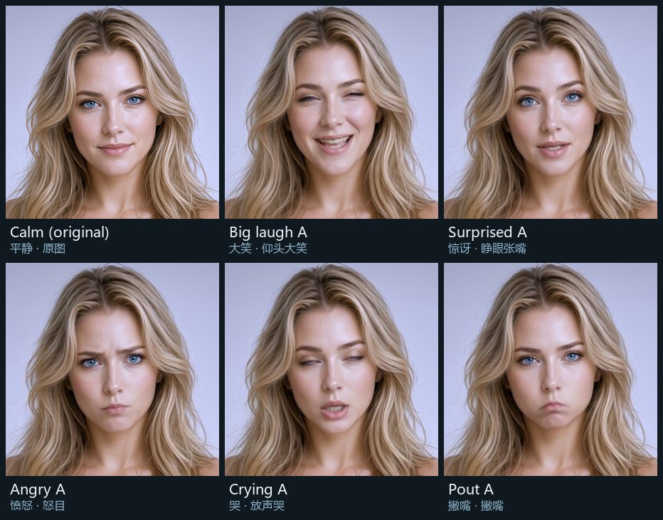
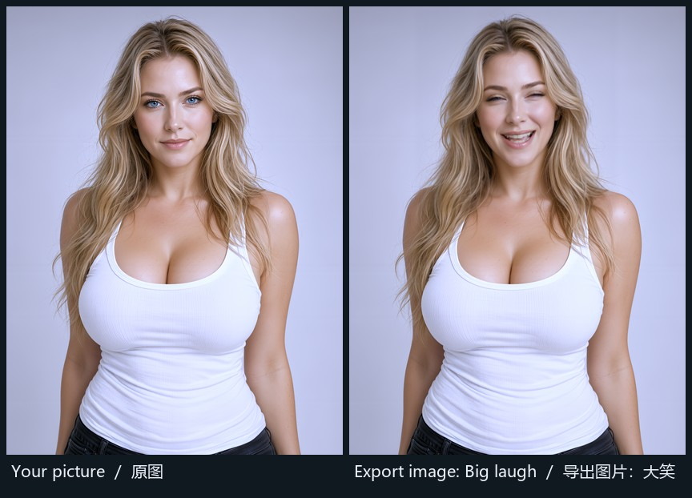
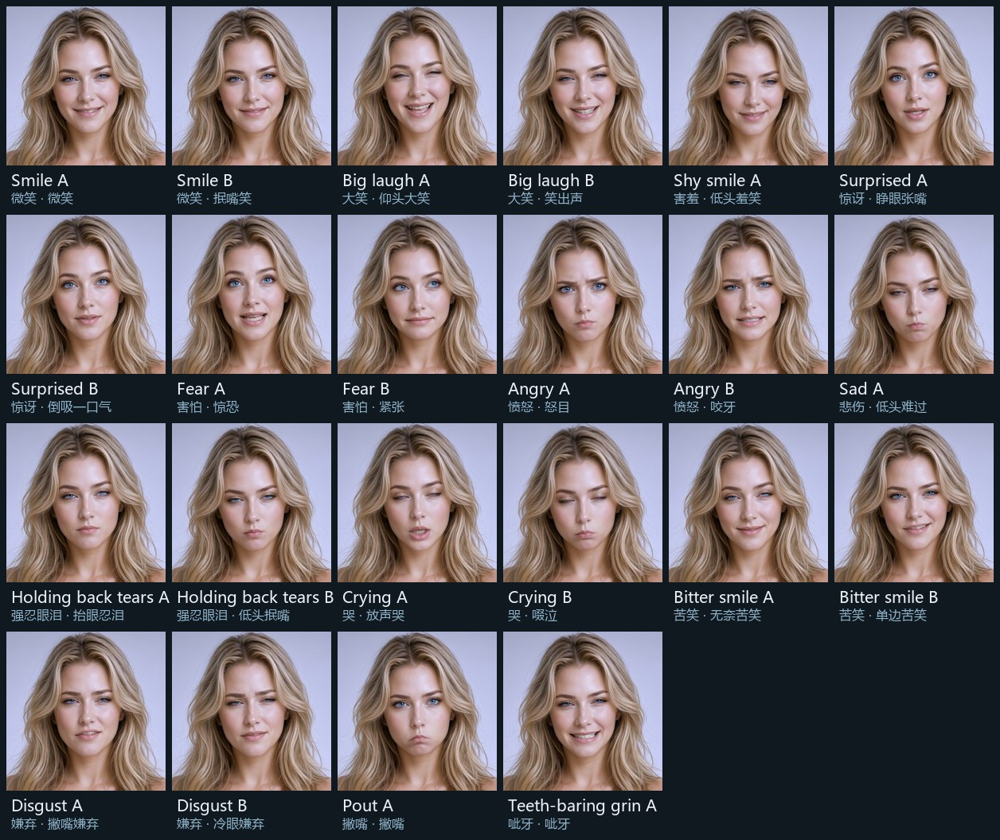

# H3MD Expression Studio

**[中文说明](README.zh-CN.md)**

Give any face a precise expression — by sliders, from a built-in library, or copied from a video — and use it as:

- **a MiniMax H3 RefMod** (a short expression clip H3 follows), for H3 / [H3MD Director](https://github.com/1113800942/comfy-h3md-director) short dramas, or
- **a plain picture**: your photo, full size, with the new expression — for keyframes or any image work. No H3 needed.

Free and open source. One package, no other ComfyUI plugin to install.

## Examples

**MiniMax H3 videos driven by an expression RefMod** (H3MD Director)

| Surprised | Holding back tears |
|:---:|:---:|
|  |  |

**One picture, many expressions** — the calm original and five built-in expressions



**Export image** — the whole picture at its own size, only the expression changed



<details><summary>All 22 built-in expressions</summary>



</details>

## What you get

One node, **H3MD Expression Studio**. Its button opens a full-screen studio:

- **Load Image** — the character's picture (portrait, half body or full body).
- **Expression library** — 22 built-in expressions (smile, big laugh, shy, surprised, fear, angry, sad, holding back tears, crying, bitter smile, disgust, pout, teeth-baring grin …) plus your own. Thumbnails can be drawn on your own picture. Rename or delete any of them; deleted built-ins can be restored.
- **Sliders by face part** — brows, eyes, cheeks, mouth (corners, each corner on its own, press, stretch, pucker, open), head turn. Live preview, undo / redo, **Reset** back to the calm face.
- **Load Video** — copy an expression from a short close-up clip (up to 6 s). A warning appears when the face is too small or turned away.
- **Play** the 39-frame expression clip; drag the timeline to any frame.
- **Export image** — the frame the timeline is on, as a PNG in ComfyUI's `output` folder: the whole picture at its own size with the new expression, or tick **Face only** for the 512 × 512 face.
- **Save expression only (no face)** — into your library, to use on any character.
- **Save character + expression** — makes the RefMod right away and shows the matching prompt line with a **Copy prompt** button. Pick the RefMod in H3MD Director's RefMod list and paste the line into the shot's prompt.
- **Whole set** — RefMods of every library expression for one character in one go.

The interface follows ComfyUI's language setting (English / 中文).

## Install

ComfyUI Manager: search **H3MD Expression**. Or:

```
cd ComfyUI/custom_nodes
git clone https://github.com/1113800942/ComfyUI-H3MD-Expression
```

Restart ComfyUI. No pip packages beyond a standard ComfyUI install.

On first use the LivePortrait face models (about 520 MB) download to `models/liveportrait`. If you already have them there (from another LivePortrait plugin), they are used as they are.

Example workflow: `example_workflows/H3MD_Expression.json`.

## What else is needed

| For | Needs |
|---|---|
| Studio, library, sliders, video copy, **Export image** | nothing else |
| **RefMods** for H3 | MiniMax H3 video VAE (`minimax_h3_video_vae_fp16.safetensors` in `models/vae`) and the H3 RefMod nodes (ComfyUI-MiniMaxH3Mod) — what H3 RefMod users already have |
| Writing an expression's description in **Chinese** (translated to English for the prompt) | any Qwen3-VL text encoder in `models/text_encoders` (4B is enough). English descriptions need nothing. |

## Limits

The face is moved, not repainted: tears, nose wrinkles and forehead lines can't be drawn — describe those in the video prompt. Video copying works best on steady, close, front-facing faces.

## Licenses

This package: AGPL-3.0-or-later. It contains LivePortrait network code (Kuaishou, MIT) and OpenCV's YuNet face detector (MIT); see [THIRD_PARTY_NOTICES.md](THIRD_PARTY_NOTICES.md). It does not use InsightFace models or YOLO.
