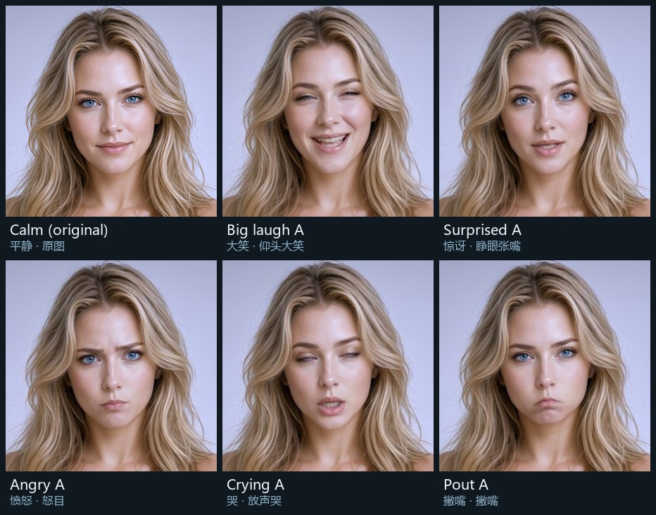
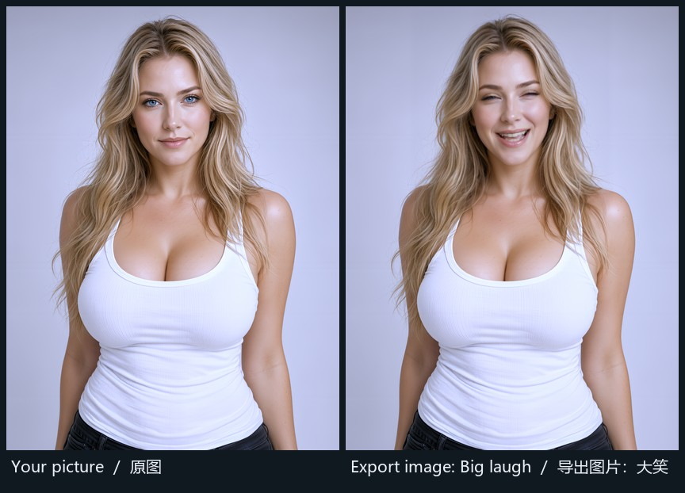
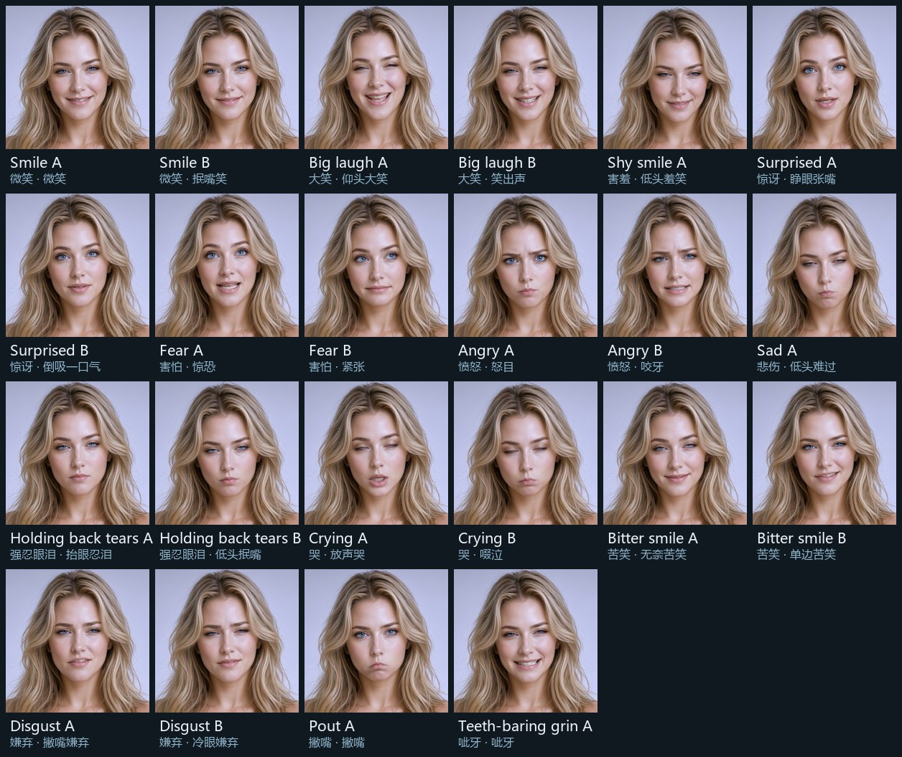

# H3MD 表情工作台

**[English](README.md)**

给任何一张脸做出准确的表情：拖滑块、从内置表情库选，或者从视频里抄。做好的表情可以用作：

- **MiniMax H3 的 RefMod**（一小段表情片段，H3 会跟着做），给 H3 / [H3MD 导演台](https://github.com/1113800942/comfy-h3md-director) 拍短剧用；
- **一张普通图片**：你的原图、原尺寸，换上新表情，做关键帧或任何图片编辑都行，不需要 H3。

免费开源。只装这一个包，不用再装别的 ComfyUI 插件。

## 示例

**用表情 RefMod 驱动的 MiniMax H3 视频**（H3MD 导演台）

| 惊讶 | 强忍眼泪 |
|:---:|:---:|
|  |  |

**一张图，多种表情**：平静的原图和 5 个内置表情



**导出图片**：整张原尺寸图片，只换表情



<details><summary>全部 22 个内置表情</summary>



</details>

## 功能

一个节点：**H3MD 表情工作台**。点节点上的按钮打开全屏工作台：

- **加载图片**：角色照片，大头、半身、全身都行。
- **表情库**：内置 22 个表情（微笑、大笑、害羞、惊讶、害怕、愤怒、悲伤、强忍眼泪、哭、苦笑、嫌弃、撇嘴、呲牙……），加上你自己存的。缩略图可以画在你自己的图上。每个表情都能改名、删除，删掉的内置表情能一键恢复。
- **分部位滑块**：眉毛、眼睛、脸颊、嘴（嘴角、单边嘴角、抿嘴、咧嘴、嘟嘴、张嘴）、头部转动。实时预览，可撤销/重做，**重置**一键回到平静脸。
- **加载视频**：从一小段近景视频（6 秒以内）里抄表情。脸太小或转得太侧时会提示。
- **播放** 39 帧的表情片段；时间轴可以拖到任意一帧。
- **导出图片**：时间轴停在哪一帧就导出哪一帧，PNG 存进 ComfyUI 的 `output` 文件夹。默认导出整张原尺寸图片；勾上**只要脸部**则导出 512×512 的脸。
- **只存表情（不带脸）**：存进你的表情库，任何角色都能用。
- **保存人物＋表情**：马上做出 RefMod，并显示对应的提示词和**复制提示词**按钮。在导演台的 RefMod 列表里选它，把提示词贴进镜头提示词。
- **整套生成**：一次给一个角色把表情库里所有表情都做成 RefMod。

界面跟随 ComfyUI 的语言设置（中文 / English）。

## 安装

ComfyUI Manager 里搜 **H3MD Expression**，或者：

```
cd ComfyUI/custom_nodes
git clone https://github.com/1113800942/ComfyUI-H3MD-Expression
```

也可以从抱抱脸镜像下载压缩包：https://huggingface.co/yj0942/H3MD-Expression

重启 ComfyUI。除了 ComfyUI 本身自带的，不需要装任何 pip 包。

第一次使用时会自动下载 LivePortrait 的人脸模型（约 520 MB）到 `models/liveportrait`。如果你装过别的 LivePortrait 插件、那里已经有了，就直接用。

示例工作流：`example_workflows/H3MD_Expression.json`。

## 还需要什么

| 用途 | 需要 |
|---|---|
| 工作台、表情库、滑块、视频抄表情、**导出图片** | 什么都不用 |
| 给 H3 做 **RefMod** | MiniMax H3 视频 VAE（`models/vae` 里的 `minimax_h3_video_vae_fp16.safetensors`）和 H3 RefMod 节点（ComfyUI-MiniMaxH3Mod），用 H3 RefMod 的人本来就有 |
| 用**中文**写表情描述（自动翻成英文提示词） | `models/text_encoders` 里任意一个 Qwen3-VL 文本编码器（4B 就够）。用英文写描述则什么都不用。 |

## 限制

它是挪动脸部，不是重画：画不出眼泪、皱鼻子、额头皱纹，这些要写进视频提示词。从视频抄表情时，脸要稳、要近、要接近正脸效果才好。

## 许可证

本包：AGPL-3.0-or-later。包内含快手 LivePortrait 的网络代码（MIT）和 OpenCV 的 YuNet 人脸检测（MIT），详见 [THIRD_PARTY_NOTICES.md](THIRD_PARTY_NOTICES.md)。不使用 InsightFace 模型，也不使用 YOLO。
